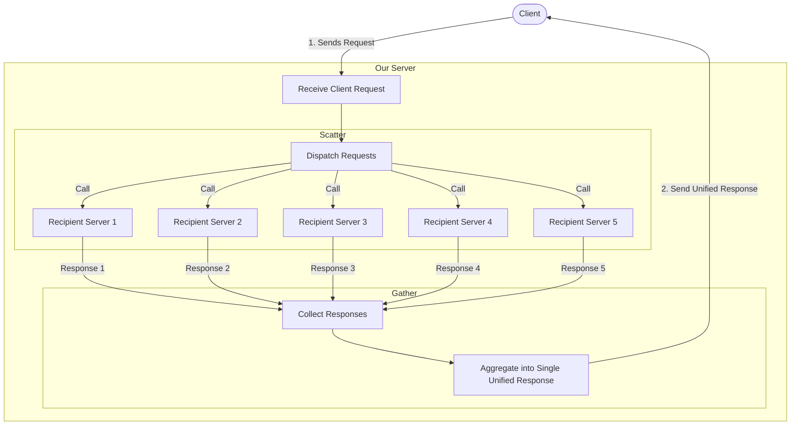

# Scatter Gatter Pattern
This pattern runs in two phase (i.e, scatter phase and gatter phase). 

In scatter phase the cordinator server broadcast requests to multiple receipent servers. The receipent server sends the response to the cordinator server.

In gatter phase the cordinator server combines the response received from the receipents and returns the unified response

## diagram


## To run this
```
npm run dev:server  // For running main server
npm run dev:mock-server  // For running mock server
```

## Testing endpoint
```
# Main server - q = product_name, cat = product_category
curl http://localhost:3000/products?q=iphone&cat=Electronics

# Mock server -
# Main server sends the requests to mock server with this url
# q = product_name, cat = product_category, platform = products_platform, delay = miliseconds and fr = failure rate range (0 -> 0.10)
curl http://localhost:4000/products?q=iphone&cat=Electronics&platform=flipkart&delay=500&fr=0.2
```
